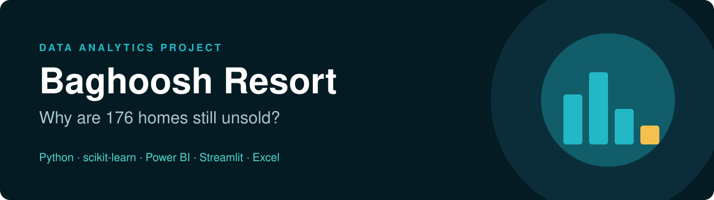
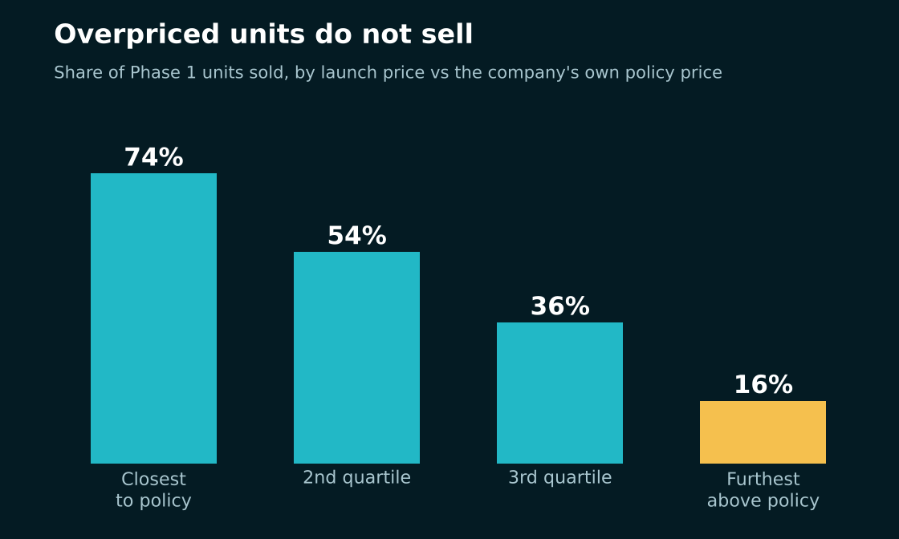
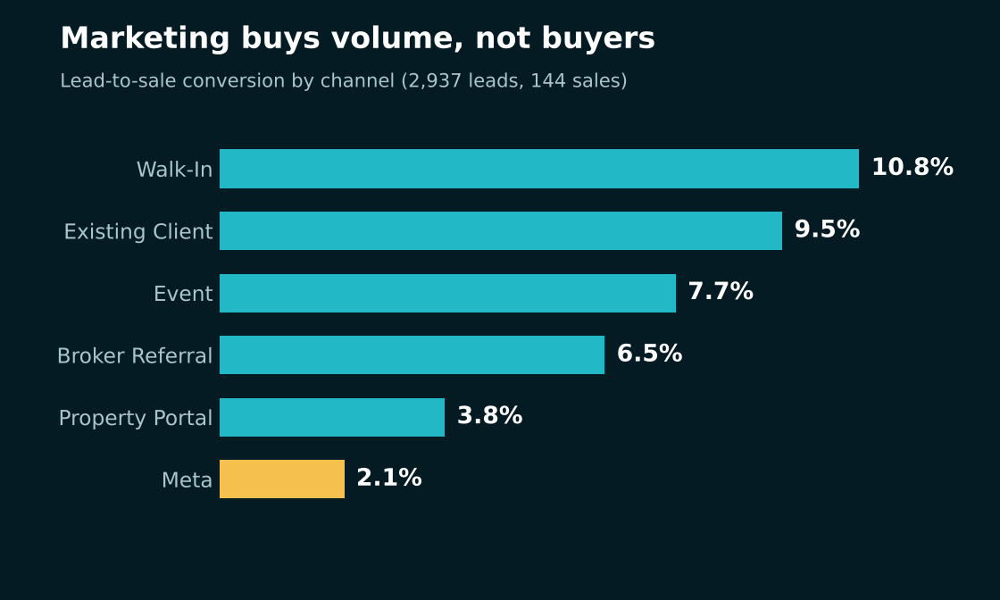
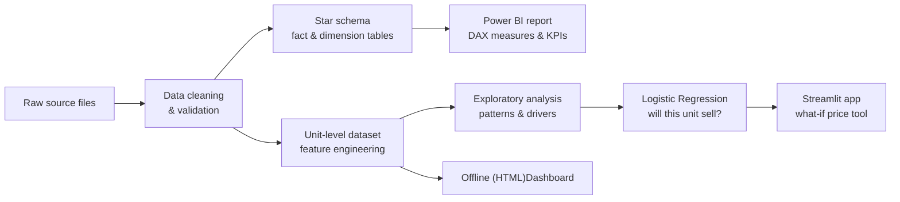
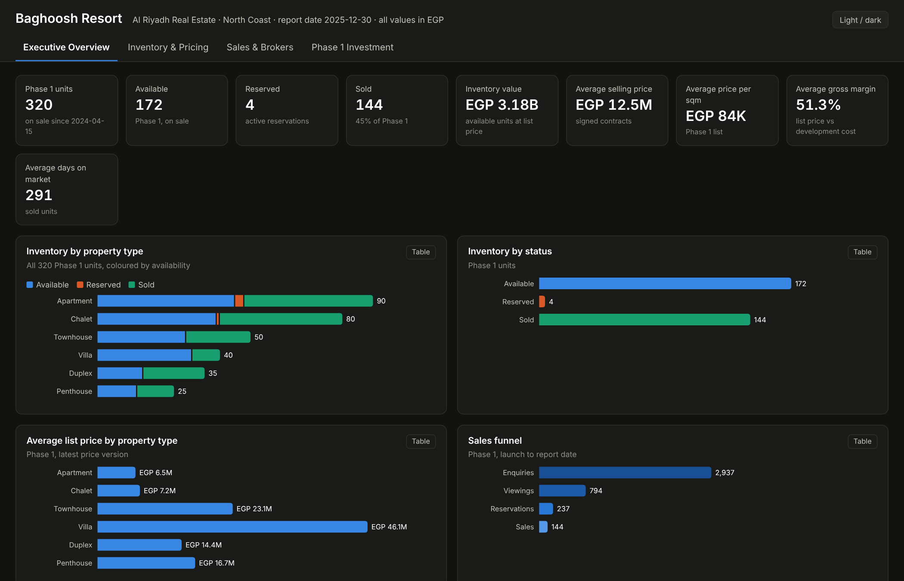
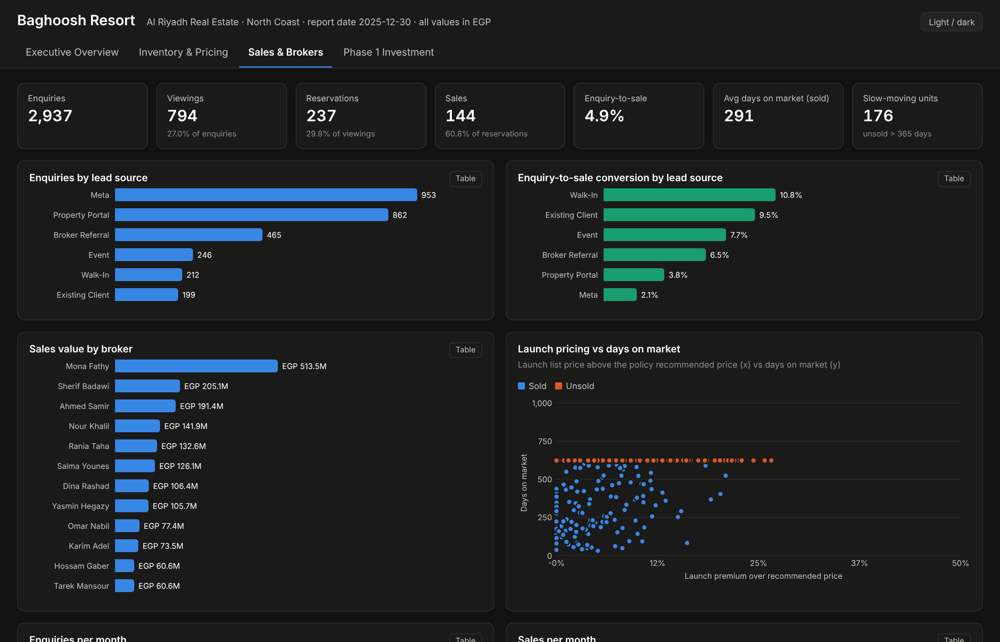

<p align="center">
  
</p>

<p align="center">
  
  
  
  
</p>
<p align="center">
  
  
  
  
</p>
<p align="center">
  
  
  
  
</p>
<p align="center">
  
  
  
</p>
<p align="center">
  
  
</p>

<h3 align="center">From 15 messy department files to a pricing answer, a prediction model and three dashboards</h3>

<br>

## The question

**Al Riyadh Real Estate** (a fictional Egyptian developer) is selling **Baghoosh Resort** on the North Coast.
Phase 1 has 320 homes on sale since April 2024, and sales are slowing.

> **Which units are not selling, why, and what should change before handover starts in August 2026?**

<table>
  <tr>
    <td align="center"><h2>144 / 320</h2>units sold (45%)</td>
    <td align="center"><h2>1.79B EGP</h2>contracted revenue</td>
    <td align="center"><h2>~2.5 years</h2>to sell the rest at the current pace</td>
    <td align="center"><h2>121</h2>data problems cleaned</td>
    <td align="center"><h2>0.70</h2>model accuracy (cross-validated)</td>
  </tr>
</table>

> [!NOTE]
> All data is **synthetic**. It was generated to behave like real company data, including the mess: a clean "truth" was
> built first and then damaged on purpose, which made it possible to grade the cleaning against an answer key.

<br>

## What I found

<table>
  <tr>
    <td width="50%"></td>
    <td width="50%"></td>
  </tr>
</table>

| # | Finding | Evidence |
|:-:|---|---|
| 1 | **Pricing above the company's own policy price is the main reason units do not sell** | Units launched closest to the policy price sold **74%**. Units about 15% above it sold **16%**. |
| 2 | **Sales are slowing** | About 6 sales a month since April 2025. The remaining 176 units need about 2.5 years, which is after handover. |
| 3 | **Villas are the weak spot, and it is a pricing problem** | 22% of villas sold, and 15% of pool villas. Once price is in the model, the pool itself has almost no effect. |
| 4 | **Marketing buys volume, not buyers** | Meta brings 32% of leads and converts 2.1%. Walk-ins convert 10.8%. |
| 5 | **Sales depend on a few brokers** | One broker closed 29% of all contract value. 137 leads have no broker at all. |
| 6 | **Construction is behind plan** | 64.3% built against 68.6% planned, with all 28 Phase 1 buildings behind. |

<br>

## How it was built



### 1. Cleaning 15 files that did not agree

The source files came from ERP, CRM, Finance, Commercial, GIS, PMO and Market research. Examples of what was wrong:

- 20 spellings of 6 property types, and Yes/No written in 10 formats
- Areas stored as text (`105 sqm`) or impossible (−259 sqm, 2,030 sqm)
- List prices 10× too high, or below their own cash price
- Duplicate leads and units, orphan viewings, four date formats in one column

Every fix followed one of four rules, and every decision was logged with a row count:

| Rule | When | Example |
|---|---|---|
| **Fix** | another source proves the right value | list price rebuilt from cash price ÷ 0.88 |
| **Fill** | a small gap can use a group median | bathrooms by property type and bedrooms |
| **Label** | the value cannot be known | `Unknown` view, `Unassigned` broker |
| **Drop** | duplicates and orphans only | 18 duplicate unit rows |

**How I know it worked:** against the answer key, 38 of 39 issue types were detected at exactly the planted count, and
all 712 prices were recovered exactly. Cross-checks also hold: "won" leads = 144 = signed contracts.

### 2. The feature that explained the problem

Raw price per sqm does not show over-pricing, because better units justify higher prices. So I rebuilt the company's
own pricing policy for every unit and measured the gap:

```
price vs policy = launch price ÷ ( cost ÷ (1 − target margin) × premiums ) − 1
```

This one engineered feature became the strongest predictor in the model.

### 3. A model that prices the risk

**Question:** will this Phase 1 unit sell? (320 units, 45% sold, baseline accuracy 0.55)

| Cross-validated (5 folds) | Logistic Regression (chosen) | Random Forest |
|---|:-:|:-:|
| Accuracy | **0.70** | 0.68 |
| F1 | **0.66** | 0.61 |
| ROC AUC | **0.75** | 0.73 |

- **9 features, all known on launch day.** The first attempt with all 18 raw columns scored 0.63.
- **No data leakage.** Price cuts, leads, viewings, reservations and sale columns are excluded, because they happen during or because of selling.
- **Why Logistic Regression:** better on every score, finds more of the units that sell, overfits less, and is easy to explain.

<br>

## The dashboards

<p align="center">
  
</p>
<p align="center">
  
</p>

| Dashboard | For | What it does | Open it |
|---|---|---|---|
| **Power BI** | management | 5 pages on a star schema: overview, inventory and pricing, sales and lead sources, broker performance, investment outlook | `powerbi_dashboard/Baghoosh.pbip` |
| **Streamlit** | the sales team | filters, KPIs, and a prediction tab: change a unit's price or payment plan and see the chance of selling move | `streamlit run app.py` |
| **HTML** | anyone | 4 pages in one self-contained file, no software needed | `outputs/Baghoosh_Dashboard.html` |

<br>

## What I would tell management

1. **Re-anchor overpriced units to the policy price.** No across-the-board cuts: the median launch margin is 49% against a policy minimum of 18–22%.
2. **Give villas their own plan.** A 22% sell-through needs a dedicated price and offer.
3. **Push long payment plans** before cash discounts. Easy plans draw more enquiries.
4. **Shift marketing budget** from Meta towards referrals, events and existing clients.
5. **Assign every lead a broker.** 137 unassigned leads produced no sales.
6. **Flag construction delays early.** Every Phase 1 building is behind plan.

<br>

## Repository

```
baghoosh/
├── data/
│   ├── raw/            15 source files exactly as the departments exported them
│   ├── cleansed/       clean star schema: one workbook + csv/ (read by Power BI)
│   └── _truth/         hidden truth + answer key of the 1,282 planted problems (grading only)
├── outputs/
│   ├── Baghoosh_Analysis.xlsx    features, EDA and investment estimates (read by Power BI)
│   └── Baghoosh_Dashboard.html   offline interactive dashboard
├── python_dashboard/
│   ├── analysis.ipynb            cleaning, wrangling, EDA, charts, findings, ML
│   ├── app.py                    Streamlit dashboard
│   ├── data/                     raw copy + cleaned outputs used by the app
│   └── models/model.joblib       trained pipeline (preprocessing + model)
├── powerbi_dashboard/            Power BI project (.pbip: report and model as text files)
└── assets/                       images used in this README
```

<br>

## Run it

<details>
<summary><b>Streamlit app and notebook</b> (Python 3.11+)</summary>

```bash
cd python_dashboard
python -m venv .venv
.venv\Scripts\activate          # Windows   (macOS / Linux: source .venv/bin/activate)
pip install -r requirements.txt
streamlit run app.py            # opens http://localhost:8501
```

To re-run the analysis, open `analysis.ipynb` and choose **Run All**. It recreates the cleaned CSVs and the model.

</details>

<details>
<summary><b>Power BI report</b> (Power BI Desktop)</summary>

Open `powerbi_dashboard/Baghoosh.pbip`. The queries read `data/cleansed/csv/` and `outputs/Baghoosh_Analysis.xlsx`
through a full path from the author's PC. Change it under **Transform data → Data source settings**, then **Refresh**.

</details>

<details>
<summary><b>HTML dashboard</b></summary>

Download `outputs/Baghoosh_Dashboard.html` and double-click it. The data is embedded in the file.

</details>

<br>

## Limits and next steps

- The data is synthetic. The patterns are realistic, but they were designed.
- 320 units is small for machine learning: scores move about ±0.04 between folds. Use the model to rank risk, not as a guarantee.
- Costs are budget rates with an allocation rule, not actual spending.

**Next:** time-to-sale (survival) analysis, a price-optimisation step per unit, and deploying the Streamlit app.

<br>

---

<p align="center">
  Built by <b>Moustafa G. Abbas</b> · Data Analyst<br>
  <sub>Python · pandas · NumPy · scikit-learn · Matplotlib · seaborn · Plotly · Streamlit · Power BI (Power Query, DAX) · Excel</sub>
</p>
